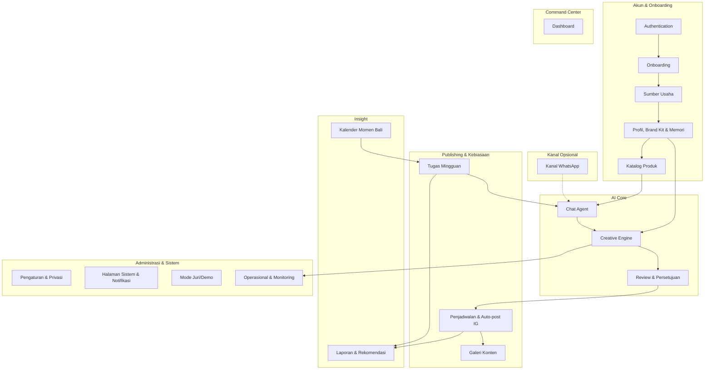
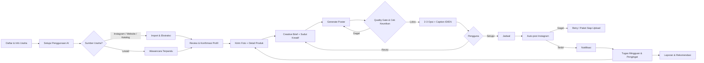

# Kriyamantra — Project Context

**Version:** 1.0
**Tanggal:** November 2026
**Status:** **PERENCANAAN & DESAIN — implementasi belum dimulai** *(asumsi; perbarui sesuai kondisi aktual)*
**Kompetisi:** Bali DigiFest 2026 — AI Web Innovation Challenge ("Build with AI, Solve for Bali")
**Dokumen terkait:** [01_PRD.md](./01_PRD.md) · Designer Guide · Panduan Peserta lomba

---

## 1. Latar Belakang

Kriyamantra adalah **website dengan asisten chat berbasis AI** yang berperan sebagai pelatih marketing pribadi bagi perajin tradisional Bali. Perajin mengirim foto dan keterangan produk; AI membuat poster yang unik, tulisan promosi Indonesia/Inggris, menjadwalkan dan memostingnya otomatis ke Instagram, lalu menemani lewat tugas marketing mingguan.

### Mengapa Dibangun?

Pelatihan digital marketing untuk UMKM sudah banyak, tetapi pelaku usaha kembali ke cara lama setelah pelatihan selesai. Temuan awal (perlu divalidasi ulang dan dilengkapi data lapangan sebelum masuk proposal):

1. **UMKM Bali belum sepenuhnya terdigitalisasi** — Dinas terkait dan Pemprov Bali mendorong digitalisasi pemasaran dan keuangan UMKM
2. **Kendala utama adalah kemampuan, bukan perangkat** — Kajian menyimpulkan hambatan ada pada kemampuan memanfaatkan teknologi
3. **UMKM berbasis budaya sulit di-onboard** — BI mencatat program onboarding UMKM berbasis budaya (termasuk di Bali) masih menghadapi banyak kendala
4. **Cara lama bertahan** — Contoh lapangan: perajin tenun di Karangasem masih menitipkan produk ke toko lokal
5. **Kesenjangan solusi** — Pelatihan dan generator konten tidak menjawab kebiasaan yang tidak terbentuk, beban membuat konten yang konsisten, dan kebutuhan konten dua bahasa untuk turis

**Sumber awal:**
- https://bali.antaranews.com/berita/376565/pemprov-bali-dongkrak-digitalisasi-pemasaran-dan-keuangan-umkm
- https://ejournal.unma.ac.id/index.php/entrepreneur/article/download/19140/8561/81244
- https://www.bi.go.id/id/bi-institute/BI-Epsilon/Pages/Tantangan-Digitalisasi-UMKM-Berbasis-Budaya.aspx
- https://ejurnal.umri.ac.id/index.php/PengabdianUMRI/article/download/9288/3718

### Tujuan Produk

- **Mengerjakan bersama perajin**, bukan hanya mengajari
- Menghasilkan **poster yang selalu unik** namun tetap konsisten secara identitas brand
- Menjaga **kebiasaan marketing** lewat tugas mingguan dan pengingat
- Membuat AI yang **mengenal usaha** (memori per usaha) dari sumber yang sudah ada atau wawancara terpandu
- Menjaga **kendali pengguna**, kejujuran, dan privasi (persetujuan eksplisit, fakta berlabel sumber)
- Memenuhi **syarat MVP lomba**: berfungsi, dapat diuji juri, AI terintegrasi secara material

### Keterkaitan dengan Project Sebelumnya (Pre-existing)

Kriyamantra **dibangun baru untuk kompetisi**, tetapi memakai ulang sebagian kecil dari **CibiOne CMS** (CMS website sekolah) yang dikembangkan sendiri. CibiOne CMS bertujuan mengelola konten sekolah, bukan marketing perajin, dan tidak membuat gambar.

| Komponen | Status | Catatan |
|----------|--------|---------|
| Pola AI pembuat deskripsi dari gambar + keterangan berbasis template | Pre-existing (CibiOne CMS) | Dipakai sebagai fondasi; konteks dan tujuan berbeda |
| Fitur auto-post Instagram | Pre-existing | Asal: [ISI — di CibiOne CMS atau project lain] |
| Creative engine (brief, sudut kreatif, quality gate, cek keunikan) | Baru | |
| Memori per usaha dan profil terstruktur | Baru | |
| Import sumber usaha + wawancara terpandu | Baru | |
| Chat agent, penjadwalan, tugas mingguan, dashboard | Baru | |

> Disclosure pre-existing wajib jujur dan dapat ditunjukkan di kode saat technical verification.

---

## 2. Business Domain

### Industri

**UMKM Kerajinan Tradisional Bali & Digital Marketing** — Usaha mikro/kecil yang membuat dan menjual produk kerajinan, tekstil, kuliner khas, dan jamu kepada pembeli lokal dan wisatawan. Produk membantu perajin tampil di media sosial tanpa perlu keahlian desain dan penulisan.

### Proses Bisnis Inti

```
Daftar → Setujui Penggunaan AI → Kenali Usaha (sumber/wawancara) → Konfirmasi Profil & Gaya →
Kirim Foto + Detail Produk → Generate Poster & Caption → Review/Revisi → Persetujuan →
Penjadwalan → Auto-post Instagram → Tugas Mingguan & Pengingat → (Laporan & Rekomendasi)
```

### Tipe Output Konten

| Tipe | Deskripsi | Format / Platform |
|------|-----------|-------------------|
| **Poster Feed** | Poster promosi AI unik per permintaan | Instagram feed, rasio 4:5 |
| **Poster Story** | Versi vertikal dengan safe area | Instagram story, rasio 9:16 |
| **Caption Indonesia** | Tulisan promosi sesuai gaya bahasa usaha | Teks + hashtag |
| **Caption Inggris** | Terjemahan setara untuk wisatawan | Tab terpisah |
| **Paket Siap-Upload** | Gambar + caption + hashtag untuk diunduh | Untuk yang tanpa Instagram dan pengganti TikTok |

---

## 3. Struktur Tim & Stakeholder

### Organisasi

```
KRIYAMANTRA
├── Tim Inti
│   ├── Ketua Tim / PIC (kontak utama panitia, penanggung jawab submission)
│   ├── Developer
│   └── Designer (menentukan tema visual)
│
├── Pengguna
│   ├── Perajin / UMKM (pengguna utama; pilot 3-5 perajin)
│   └── Pendamping UMKM (pengembangan mendatang)
│
├── Evaluator
│   └── Juri Bali DigiFest 2026 (menguji lewat akun demo)
│
└── Pihak Ketiga
    ├── Penyedia model AI (teks/vision, gambar, embedding, STT)
    ├── Meta (Instagram API; WhatsApp Business Cloud API opsional)
    └── Hosting & storage
```

### Role-to-System Mapping

> *Usulan; sesuaikan dengan keputusan teknis tim.*

| Role Bisnis | System Role | Tanggung Jawab Utama di Sistem |
|-------------|-------------|-------------------------------|
| Perajin / Pemilik usaha | `CRAFTER` | Onboarding, input produk, revisi, persetujuan, jadwal, tugas mingguan; hanya melihat data usahanya sendiri |
| Tim internal | `ADMIN` | Monitoring AI/biaya/kuota, health check, dukungan teknis (tanpa akses token mentah) |
| Juri lomba | `DEMO_JUDGE` | Menguji alur lewat akun demo dengan data contoh (sandbox) |
| Pendamping UMKM | `ADVISOR` | *(P2)* Melihat ringkasan aktivitas banyak perajin dampingan |

---

## 4. System Vision

### Dari "Pelatihan Sekali Lalu" ke Pelatih yang Menemani

> **"Perajin tidak perlu belajar jadi pemasar. Kriyamantra yang mengerjakan, perajin yang memutuskan."**

Kriyamantra harus menjadi **pelatih yang bekerja bersama pengguna** di mana:

1. Perajin cukup memberi **foto dan cerita**; AI membuat sisanya
2. Setiap poster **unik**, tetapi identitas brand perajin **konsisten**
3. AI **mengenal usaha** dan mengingat produk, gaya visual, dan gaya bahasa
4. Setiap fakta di profil memiliki **sumber dan status konfirmasi**
5. **Tidak ada posting tanpa persetujuan** eksplisit
6. Promosi tidak berhenti karena ada **tugas kecil dan pengingat** tiap minggu

### Core Principles

| ID | Prinsip | Deskripsi |
|----|---------|-----------|
| CP-01 | **Kerjakan, Jangan Ajari** | Beban kerja pengguna sekecil mungkin: foto + keterangan, lalu AI bekerja |
| CP-02 | **Unik tapi Konsisten** | Identitas (palet, vibe, logo, gaya bahasa) tetap; komposisi, konsep, dan sudut selalu berubah |
| CP-03 | **Persetujuan Manusia** | Tidak ada posting tanpa persetujuan eksplisit; semua hasil AI dapat direvisi |
| CP-04 | **Fakta Berlabel Sumber** | Setiap isian profil berlabel (Diisi pengguna / Instagram / Website / Katalog / Tebakan AI) dan harus dikonfirmasi |
| CP-05 | **Tidak Mengarang** | Tidak membuat klaim produk, harga, atau makna budaya yang tidak diberikan pengguna |
| CP-06 | **Satu Otak, Banyak Kanal** | Satu agent core dan database untuk chat web (dan WhatsApp jika aktif) |
| CP-07 | **Sederhana & Mobile-first** | Bahasa awam, sedikit langkah, target sentuh besar, kontras baik |
| CP-08 | **Privasi & Kendali Data** | Persetujuan eksplisit, minimalisasi data, hak lihat/ubah/hapus |
| CP-09 | **Transparan soal AI** | Penanda "dibuat AI" dan penanda "tebakan AI" yang jujur namun tidak menakutkan |

---

## 5. Performance & Architecture Guidelines

### Prinsip Utama

> **"Write only what the task needs, and never cut validation, error handling, security, or accessibility."**

Kriyamantra dibangun dengan prinsip **MVP yang stabil**, **maintainable**, dan **dapat dijelaskan**. Juri akan meminta pengembang menunjukkan kode panggilan AI dan menjelaskan keputusan teknis; kode yang tidak dipahami tim adalah risiko.

### Development Philosophy

```
1. Does this need to exist?   → no: skip it (YAGNI)
2. Already in this codebase?  → reuse it, don't rewrite
3. Stdlib does it?            → use it
4. Native platform feature?   → use it
5. Installed dependency?      → use it
6. One line?                  → one line
7. Only then: the minimum that works
```

Prioritas: **satu alur utama yang solid** (foto → poster → persetujuan → auto-post Instagram) lebih penting daripada banyak fitur setengah jadi.

### Arsitektur Aplikasi

> Stack belum ditetapkan di dokumen ini (lihat §6). Struktur di bawah bersifat **konseptual** dan dipetakan ke framework pilihan tim.

**Struktur Per-Modul (konseptual):**

```
modules/
  onboarding/
  business-sources/          ← import Instagram, katalog, website, wawancara
  business-memory/           ← profil, brand kit, memori konten
  catalog/
  chat-agent/                ← agent core + adapter kanal (web, whatsapp opsional)
  creative-engine/
    brief-generator
    poster-generator
    quality-gate
    uniqueness-check
    caption-writer
  review/
  scheduling/                ← scheduler, instagram publisher, retry
  weekly-tasks/
  dashboard/
  gallery/
  reports/                   ← P1/P2
  moments/                   ← P1
  settings-privacy/
  demo-mode/
  ops-monitoring/
shared/
  ui-components/
  ai-clients/                ← pembungkus panggilan model (satu pintu, logging biaya)
  integrations/              ← instagram, whatsapp (opsional)
  lib/                       ← validasi, helper, config
```

### Pemisahan State

- **Server state** (data usaha, produk, konten, jadwal, tugas) — diambil dari API; cache dan refetch dikelola konsisten
- **UI state** (tab aktif, modal, filter, langkah wizard) — lokal per halaman/modul, minimal
- Jangan mencampur keduanya dalam satu store besar

### Backend Architecture

#### API Layer Structure (usulan, REST)

```
/api/
  auth/
  businesses/
    [id]/profile
    [id]/brand-kit
    [id]/memory
    [id]/sources
  products/
    [id]/images
  chat/
    messages               ← kirim pesan/foto, ambil riwayat
  generations/
    [id]                   ← status & hasil (asinkron)
    [id]/revisions
    [id]/approve
  posts/
    [id]/schedule
    [id]/package           ← paket siap-upload
  tasks/
    weekly
    [id]/status
  integrations/
    instagram/connect
    instagram/status
    instagram/disconnect
  reports/                 ← P1/P2
  moments/                 ← P1
  privacy/
    consents
    delete-data
  webhooks/
    whatsapp               ← opsional
  cron/
    publish-due-posts
    generate-weekly-tasks
    refresh-instagram-tokens
```

Semua endpoint **wajib** memeriksa autentikasi dan **kepemilikan usaha** (isolasi tenant).

#### Pola Antrean untuk Proses AI (Wajib)

Pembuatan poster memakan waktu (±1-2 menit) dan tidak boleh memblokir request.

```
// pseudocode (bahasa-agnostik)
POST /api/generations:
  validasi input + kuota
  buat record generation { status: "pending", businessId, productId }
  masukkan job ke antrean
  return { generationId }              ← segera

worker(job):
  brief   = briefGenerator(product, brandKit, recentPosters, moment)
  options = posterGenerator(brief)
  for each option: gate = qualityGate(option); unik = uniquenessCheck(option)
  retry terbatas bila gagal
  simpan hasil + skor; status = "ready" | "failed"
  kirim notifikasi

client: polling GET /api/generations/:id hingga status bukan "pending"
```

#### Idempotency

Posting terjadwal dan webhook (WhatsApp, jika aktif) wajib **idempotent**: pemrosesan ulang permintaan yang sama tidak boleh memposting dua kali.

### AI Architecture

#### Komponen AI

| Komponen | Fungsi | Kegagalan ditangani dengan |
|----------|--------|----------------------------|
| Ekstraksi profil | Sumber (caption, halaman, foto katalog, wawancara) → profil terstruktur + label sumber + keyakinan | Tampil sebagai draf; field ragu ditanyakan ke pengguna |
| Agent percakapan | Mengatur alur chat marketing, bertanya data kurang, menangani revisi | Jawaban fallback singkat; batas konteks |
| Memori | Menyimpan/mengambil profil, katalog, riwayat konten | Retrieval terbatas, ringkasan berkala |
| Creative brief generator | Brief unik per permintaan | Validasi skema; ulang bila tidak valid |
| Generator poster | Gambar poster 2-3 opsi | Retry; fallback bertanda |
| Quality gate | Memeriksa hasil | Retry dengan brief diperbaiki |
| Cek keunikan | Bandingkan dengan poster lama | Regenerate dengan sudut berbeda |
| Penulis caption/terjemahan | Caption ID + EN + hashtag | Validasi panjang/bahasa |
| Speech-to-text (P1) | Transkripsi voice note | Fallback minta ketik |
| Pembuat tugas/rekomendasi | Tugas mingguan dan saran | Template tugas dasar |

Model spesifik: **[MODEL_TEKS/AGENT], [MODEL_GAMBAR], [MODEL_EMBEDDING], [MODEL_STT]** — alasan pemilihan wajib dapat dijelaskan di technical verification.

#### Pipeline Poster Unik

```
Produk + Brand Kit + Riwayat poster + Momen
        │
        ▼
 1. Creative Brief (LLM)  ──►  2. Pilih Sudut Kreatif (≠ poster-poster terakhir)
        │
        ▼
 3. Generate 2-3 opsi (foto produk sebagai referensi, brand kit sebagai batasan)
        │
        ▼
 4. Quality Gate ── teks terbaca & benar (OCR) · produk tidak berubah · sesuai brand · tanpa artefak
        │ gagal → retry (maks. 3) → fallback bertanda
        ▼
 5. Cek Keunikan ── embedding vs N poster terakhir
        │ terlalu mirip → regenerate dengan sudut berbeda
        ▼
 6. 2-3 opsi → pengguna memilih/merevisi/menyetujui
```

**Parameter awal *(target awal, dituning lewat uji)*:** retry maksimal 3; ambang kemiripan titik awal cosine 0,85; bandingkan dengan 20 poster terakhir; kuota generate per usaha per jam/hari.

#### Guardrail

- Tidak mengarang klaim (asli, organik, halal, bersertifikat, medis); harga hanya dari input pengguna
- Tidak mengubah bentuk/warna produk asli
- Cerita budaya hanya dari penjelasan perajin; bila ragu, AI bertanya
- Konten impor (caption, halaman web, dokumen) diperlakukan sebagai **data**, tidak pernah sebagai instruksi (anti prompt injection)
- Bot dibatasi pada fungsi marketing
- Patuhi kebijakan platform soal pelabelan konten buatan AI

### Caching & Pengendalian Biaya

- Satu pintu panggilan AI (`ai-clients`) yang mencatat model, token, latensi, biaya, dan error
- Kuota generate dan batas revisi per usaha
- Cache hasil yang tidak berubah (profil terkonfirmasi, ringkasan memori)
- Impor sumber dibatasi (maks. 30 postingan, sekali saat onboarding)

### Background Jobs & Tugas Terjadwal

| Job | Fungsi |
|-----|--------|
| `publish-due-posts` | Memposting konten yang jadwalnya tiba (idempotent, retry terbatas) |
| `generate-weekly-tasks` | Membuat tugas mingguan per usaha |
| `send-reminders` | Pengingat terbatas (1-2 per minggu) |
| `refresh-instagram-tokens` | Memperpanjang token dan memberi peringatan bila perlu otorisasi ulang |

Penjadwalan dijalankan **scheduler internal**, tidak bergantung fitur jadwal platform.

### Performance Monitoring

- Catat per panggilan AI: komponen, model, token, latensi, biaya, hasil, error (`ai_runs`)
- Pantau: tingkat lolos quality gate, tingkat regenerate karena kemiripan, keberhasilan auto-post, latensi foto → poster
- Health check: database, storage, AI API, token Instagram, scheduler

---

## 6. Tech Stack

> **Belum ditetapkan.** Isi kolom `[ISI]` sesuai keputusan tim. Yang sudah pasti adalah kebutuhan fungsional dan layanan eksternal.

### Stack Aplikasi

| Layer | Teknologi | Keterangan |
|-------|-----------|------------|
| **Frontend** | [ISI] | Mobile-first, responsif; mengikuti desain dari designer |
| **Styling** | [ISI] | Memetakan design tokens dari designer |
| **Backend / Runtime** | [ISI] | API + worker antrean |
| **Database** | [ISI] | Data usaha, memori, jadwal, log; embedding disimpan sesuai kemampuan DB atau layanan vektor |
| **Auth** | [ISI] | Sesi aman; isolasi per usaha |
| **Storage Media** | [ISI] | Foto produk dan poster; URL publik HTTPS untuk publish Instagram *(verifikasi)* |
| **Scheduler / Queue** | [ISI] | Auto-post, tugas mingguan, pengingat, perpanjangan token |
| **Hosting** | [ISI] | Dapat diakses juri tanpa instalasi tidak wajar; kuota cukup selama penjurian |

### Layanan Eksternal & AI

| Layanan | Peran | Prioritas |
|---------|-------|-----------|
| Model teks/vision | Agent, ekstraksi, brief, caption, terjemahan, quality gate | Wajib |
| Model gambar | Generator poster | Wajib |
| Model embedding | Cek keunikan, retrieval memori | Wajib |
| Speech-to-text | Voice note | P1 |
| Instagram API (Business/Creator) | Baca konten milik akun + publish | Wajib (auto-post Tahap 1) |
| WhatsApp Business Cloud API | Kanal tambahan | Opsional |
| TikTok | — | Di luar Tahap 1 (paket siap-upload) |

### Build Strategy

Kriyamantra dibangun **baru**, dengan pemakaian ulang terbatas dari CibiOne CMS:

✅ **Dipakai ulang (diaudit dan diadaptasi):**
- Pola agent content generation berbasis template
- Modul auto-post Instagram (versi awal)

✅ **Dibangun baru:**
- Creative engine (brief, sudut kreatif, quality gate, cek keunikan)
- Memori per usaha, profil, brand kit
- Import sumber usaha + wawancara terpandu
- Chat agent lintas kanal, penjadwalan, tugas mingguan, dashboard

✅ **Urutan pengerjaan yang disarankan:**
1. Fondasi (repo baru, akun, database, agent core, chat web)
2. Alur inti: input produk → creative engine → persetujuan
3. **Auto-post Instagram** (uji end-to-end sedini mungkin)
4. Onboarding dan memori (profil, brand kit, wawancara, katalog, import Instagram)
5. Dashboard, jadwal, tugas mingguan
6. Evaluasi dan pilot (benchmark + 3-5 perajin)
7. Dokumentasi dan submission (README, `.env.example`, disclosure, proposal, tag versi, akun demo)
8. P1 sesuai sisa waktu; WhatsApp hanya jika sudah terverifikasi

### Keamanan Data

| Hal | Aturan |
|-----|--------|
| Token Instagram | Disimpan terenkripsi; tidak pernah terbaca di UI atau log |
| Secret/API key | Hanya environment variable; sediakan `.env.example`; **tidak ada secret di repository** |
| Backup | Terjadwal; sesuaikan dengan penyedia database |
| Data pengguna | Isolasi per usaha; hapus data atas permintaan |

---

## 7. Module Overview (19 Modul)



### Daftar Modul

> *Route bersifat usulan; sesuaikan dengan framework dan keputusan designer.*

| # | Modul | Route | Deskripsi Singkat |
|---|-------|-------|-------------------|
| 1 | **Authentication** | `/login`, `/register` | Registrasi, login, sesi, isolasi data per usaha, akun demo juri |
| 2 | **Onboarding** | `/onboarding` | Wizard 5 langkah: info usaha, persetujuan AI, sumber usaha, review profil |
| 3 | **Sumber Usaha** | `/onboarding`, `/profile` | Import Instagram (OAuth), foto katalog, website (P1), wawancara terpandu, label sumber |
| 4 | **Profil, Brand Kit & Memori** | `/profile` | Profil usaha, gaya visual, memori konten yang dapat dilihat dan dihapus |
| 5 | **Katalog Produk** | `/products` | Daftar dan detail produk, status promosi |
| 6 | **Chat Agent** | `/chat` | Percakapan dengan agent, unggah foto, kartu opsi poster, tombol cepat |
| 7 | **Creative Engine** | `/create`, `/create/:id` | Brief, sudut kreatif, generate poster, quality gate, cek keunikan, caption ID/EN |
| 8 | **Review & Persetujuan** | `/create/:id` | Pratinjau gaya Instagram, revisi bahasa alami, riwayat versi, persetujuan |
| 9 | **Penjadwalan & Auto-post IG** | `/schedule` | Kalender/daftar jadwal, status posting, retry, paket siap-upload |
| 10 | **Tugas Mingguan** | `/tasks` | Tugas, progres, pengingat |
| 11 | **Dashboard** | `/` | Ringkasan minggu, aksi utama, status koneksi |
| 12 | **Galeri Konten** | `/gallery` | Semua poster, versi, unduh |
| 13 | **Laporan & Rekomendasi** | `/reports` | Laporan aktivitas, rekomendasi (P1); metrik performa dan klik (P2) |
| 14 | **Kalender Momen Bali** | `/moments` | Hari raya, libur, musim turis → tugas/kampanye (P1) |
| 15 | **Pengaturan & Privasi** | `/settings` | Akun, bahasa, Instagram, persetujuan, hapus data |
| 16 | **Halaman Sistem & Notifikasi** | `/notifications`, halaman error | 404, error, sesi habis/offline, kuota habis, pusat notifikasi |
| 17 | **Mode Juri/Demo** | `/demo` | Penanda demo, data contoh, tur singkat, reset kondisi awal (P1) |
| 18 | **Kanal WhatsApp (Opsional)** | `/api/webhooks/whatsapp` | Adapter kanal ke agent core; template tugas/pengingat |
| 19 | **Operasional & Monitoring** | `/ops` (internal) | Log AI, biaya, kuota, audit trail, benchmark, health check |

### Referensi Detail Per Modul

Setiap modul memiliki dokumen detail di direktori `docs/`. **Wajib dibaca sebelum mengimplementasi modul apapun** — berisi fitur lengkap, field data, workflow, dan catatan. *(Dokumen dibuat pada tahap SRS; daftar di bawah adalah rencana penamaan.)*

| # | Modul | File Referensi |
|---|-------|---------------|
| 1 | Authentication | `docs/01-auth.md` |
| 2 | Onboarding | `docs/02-onboarding.md` |
| 3 | Sumber Usaha | `docs/03-business-sources.md` |
| 4 | Profil, Brand Kit & Memori | `docs/04-memory.md` |
| 5 | Katalog Produk | `docs/05-catalog.md` |
| 6 | Chat Agent | `docs/06-chat-agent.md` |
| 7 | Creative Engine | `docs/07-creative-engine.md` |
| 8 | Review & Persetujuan | `docs/08-review.md` |
| 9 | Penjadwalan & Auto-post IG | `docs/09-scheduling.md` |
| 10 | Tugas Mingguan | `docs/10-weekly-tasks.md` |
| 11 | Dashboard | `docs/11-dashboard.md` |
| 12 | Galeri Konten | `docs/12-gallery.md` |
| 13 | Laporan & Rekomendasi | `docs/13-reports.md` |
| 14 | Kalender Momen Bali | `docs/14-moments.md` |
| 15 | Pengaturan & Privasi | `docs/15-settings-privacy.md` |
| 16 | Halaman Sistem & Notifikasi | `docs/16-system-notifications.md` |
| 17 | Mode Juri/Demo | `docs/17-demo-mode.md` |
| 18 | Kanal WhatsApp | `docs/18-whatsapp.md` |
| 19 | Operasional & Monitoring | `docs/19-ops.md` |

> **Rule:** Setiap kali akan mengimplementasi sebuah modul, baca `docs/[XX]-[modul].md` yang relevan **sebelum** menulis satu baris kode. Jika ada konflik antara `docs/` dan SRS, SRS menang karena lebih up-to-date.

---

## 8. High-Level Architecture

```
┌─────────────────────────────────────────────────────────┐
│                    CLIENT (Browser, Mobile-first)        │
│  ┌───────────┐  ┌───────────┐  ┌──────────────────────┐ │
│  │ Halaman   │  │ Chat UI   │  │ Komponen UI          │ │
│  │ (Landing, │  │ (kartu    │  │ (token & komponen    │ │
│  │ Dashboard,│  │ opsi,     │  │  dari designer)      │ │
│  │ Jadwal…)  │  │ tombol)   │  │                      │ │
│  └─────┬─────┘  └─────┬─────┘  └──────────┬───────────┘ │
│        └──────────────┼───────────────────┘             │
├───────────────────────┼─────────────────────────────────┤
│                  API LAYER                               │
│  ┌────────────────────┼──────────────────────────────┐  │
│  │  ┌──────────┐ ┌──────────┐ ┌──────────┐ ┌───────┐ │  │
│  │  │ Auth     │ │ Tenant   │ │ Audit    │ │ Rate  │ │  │
│  │  │ Middleware│ │ Guard    │ │ Logger   │ │ Limit │ │  │
│  │  └──────────┘ └──────────┘ └──────────┘ └───────┘ │  │
│  │                                                    │  │
│  │  ┌──────────────────────────────────────────────┐ │  │
│  │  │ AGENT CORE (satu otak, banyak kanal)         │ │  │
│  │  │ Adapter: Web Chat · WhatsApp (opsional)      │ │  │
│  │  └────────────────┬─────────────────────────────┘ │  │
│  │  ┌────────────────▼─────────────────────────────┐ │  │
│  │  │ CREATIVE ENGINE: brief → generate → gate →   │ │  │
│  │  │ cek keunikan → caption/terjemahan            │ │  │
│  │  └────────────────┬─────────────────────────────┘ │  │
│  │  ┌────────────────▼─────────────────────────────┐ │  │
│  │  │ Scheduler / Queue: auto-post, tugas, token   │ │  │
│  │  └──────────────────────────────────────────────┘ │  │
│  └───────────────────┼───────────────────────────────┘  │
├──────────────────────┼──────────────────────────────────┤
│                  DATA LAYER                              │
│  ┌──────────────┐  ┌──────────────┐  ┌───────────────┐  │
│  │ Database     │  │ Media        │  │ External APIs │  │
│  │ (profil,     │  │ Storage      │  │ (LLM, gambar, │  │
│  │ memori,      │  │ (foto,       │  │ embedding,    │  │
│  │ jadwal, log) │  │ poster)      │  │ STT, Instagram│  │
│  │              │  │              │  │ , WA opsional)│  │
│  └──────────────┘  └──────────────┘  └───────────────┘  │
└─────────────────────────────────────────────────────────┘
```

**Keputusan Arsitektur:**

1. **Satu Agent Core, Banyak Kanal:**
   - Chat web adalah kanal utama dan yang diuji juri
   - WhatsApp (opsional) hanyalah adapter ke agent dan database yang sama

2. **Pemrosesan AI Asinkron:**
   - Generate poster lewat antrean; client polling status
   - Pengguna dapat meninggalkan halaman dan diberi tahu saat selesai

3. **Scheduler Internal:**
   - Auto-post, tugas mingguan, pengingat, dan perpanjangan token dijalankan sistem sendiri

4. **Isolasi Tenant:**
   - Setiap query dibatasi oleh `businessId` milik pengguna
   - Token dan konten satu usaha tidak pernah terlihat usaha lain

5. **Satu Pintu Panggilan AI:**
   - Semua panggilan model lewat `ai-clients` untuk logging biaya, retry, dan penanganan error konsisten

---

## 9. End-to-End Business Flow



### Step-by-Step

| Step | Modul | Owner | Input | Output |
|------|-------|-------|-------|--------|
| 1 | Authentication | Perajin | Nama, nama usaha, jenis produk | Akun |
| 2 | Onboarding | Perajin | Persetujuan penggunaan AI | Consent tercatat |
| 3 | Sumber Usaha | Perajin + Sistem | Instagram / website / foto katalog / jawaban wawancara | Fakta berlabel sumber (draf) |
| 4 | Profil & Memori | Perajin | Koreksi/konfirmasi draf | Profil dan brand kit terkonfirmasi |
| 5 | Chat Agent | Perajin | Foto (1-5) + detail produk | Permintaan generate |
| 6 | Creative Engine | Sistem | Produk, brand kit, riwayat poster, momen | Brief + sudut kreatif |
| 7 | Creative Engine | Sistem | Brief + foto referensi | 2-3 poster lolos gate dan cek keunikan |
| 8 | Review | Perajin | Revisi / edit caption | Versi final |
| 9 | Review | Perajin | Persetujuan eksplisit | Status: Disetujui |
| 10 | Penjadwalan | Sistem + Perajin | Usulan jadwal | Status: Terjadwal |
| 11 | Auto-post IG | Sistem | Poster + caption pada waktunya | Status: Terbit / Gagal |
| 12 | Tugas Mingguan | Sistem | Katalog, riwayat, momen | Tugas + pengingat |
| 13 | Laporan | Sistem | Aktivitas (dan performa, P2) | Rekomendasi |

---

## 10. RBAC Summary

### Access Matrix Overview

| Modul | CRAFTER | ADMIN | DEMO_JUDGE | ADVISOR (P2) |
|-------|---------|-------|------------|--------------|
| Authentication | Full (akun sendiri) | Read | Akun demo | Akun sendiri |
| Onboarding / Sumber Usaha | Read/Write (usahanya) | - | Sandbox | - |
| Profil, Brand Kit & Memori | Read/Write/Hapus (usahanya) | - | Sandbox | Read (dampingan) |
| Katalog Produk | Read/Write (usahanya) | - | Sandbox | Read |
| Chat Agent | Read/Write (usahanya) | - | Sandbox | - |
| Creative Engine | Read/Write (usahanya) | - | Sandbox | - |
| Review & Persetujuan | Approve (usahanya) | - | Sandbox | - |
| Penjadwalan & Auto-post | Read/Write/Batalkan (usahanya) | Read status | Sandbox | Read |
| Tugas Mingguan | Read/Write (usahanya) | - | Sandbox | Read |
| Dashboard / Galeri | Read (usahanya) | - | Sandbox | Read ringkasan |
| Laporan & Rekomendasi | Read (usahanya) | Read agregat | Sandbox | Read |
| Pengaturan & Privasi | Full (usahanya) | - | Terbatas | - |
| Operasional & Monitoring | - | Full | - | - |

### Restricted Access Rules

- **Isolasi data** — Setiap usaha hanya dapat mengakses data usahanya sendiri; berlaku di seluruh endpoint dan query
- **Token Instagram** — Tidak pernah ditampilkan di UI maupun log; ADMIN tidak dapat membacanya
- **Konten pengguna** — ADMIN tidak membuka konten/foto pengguna kecuali untuk dukungan dengan persetujuan
- **Akun demo juri** — Sandbox dengan data contoh; kredensial dikirim lewat kanal panitia, bukan repository
- **Hapus data** — Hanya pemilik usaha; tercatat di audit trail
- **Persetujuan posting** — Hanya pemilik usaha yang dapat menyetujui posting; sistem tidak pernah memposting tanpa persetujuan

---

## 11. Glossary

| Istilah | Definisi |
|---------|----------|
| **Perajin / UMKM** | Pelaku usaha mikro/kecil yang membuat dan menjual produk kerajinan, tekstil, kuliner, atau jamu |
| **Endek / Tenun** | Kain tradisional Bali/Nusantara yang dibuat dengan teknik tenun; contoh produk perajin |
| **Brand Kit** | Identitas visual dan bahasa usaha: palet, mood, logo, contoh referensi, gaya tipografi |
| **Creative Brief** | Instruksi terstruktur untuk satu poster: konsep, komposisi, mood, copy, format |
| **Sudut Kreatif** | Pendekatan visual poster (misal close-up tekstur, proses pembuatan, cerita budaya, promo) |
| **Quality Gate** | Pemeriksaan otomatis hasil AI (teks, kesetiaan produk, brand, artefak) sebelum ditampilkan |
| **Cek Keunikan** | Perbandingan poster baru dengan poster sebelumnya untuk mencegah kemiripan |
| **Memori** | Profil, katalog, dan riwayat konten per usaha yang dipakai AI sebagai konteks |
| **Sumber Usaha** | Sumber informasi usaha: Instagram, website, foto katalog, atau wawancara terpandu |
| **Label Sumber** | Penanda asal tiap fakta: Diisi pengguna / Instagram / Website / Katalog / Tebakan AI |
| **Auto-post** | Posting otomatis ke Instagram sesuai jadwal setelah persetujuan |
| **Paket Siap-Upload** | Gambar + caption + hashtag yang dapat diunduh untuk diunggah manual |
| **Akun Business/Creator** | Jenis akun Instagram profesional yang didukung API resmi |
| **OAuth** | Mekanisme login resmi untuk memberi izin akses akun tanpa membagikan password |
| **Token** | Kunci akses sementara ke akun Instagram; berumur terbatas |
| **Webhook** | Pemanggilan balik dari layanan eksternal ke sistem saat ada kejadian |
| **Jendela 24 Jam (WhatsApp)** | Periode setelah pengguna mengirim pesan, saat bisnis boleh membalas bebas |
| **Template (WhatsApp)** | Pesan yang disetujui Meta untuk dikirim di luar jendela 24 jam |
| **Idempotency** | Jaminan bahwa pemrosesan berulang atas permintaan yang sama tidak menimbulkan efek ganda |
| **Prompt Injection** | Teks yang menyisipkan instruksi untuk memanipulasi AI |
| **Embedding** | Representasi numerik teks/gambar untuk mengukur kemiripan |
| **RAG** | Retrieval-Augmented Generation — AI menjawab dengan bahan yang diambil dari sumber terkurasi |
| **OCR** | Optical Character Recognition — pembacaan teks dari gambar |
| **STT** | Speech-to-Text — transkripsi suara menjadi teks |
| **MVP** | Minimum Viable Product — versi awal yang fungsi utamanya dapat dipakai dan didemonstrasikan |
| **Eligible AI** | AI yang menjadi bagian material dari fungsi utama produk (bukan sekadar membantu coding) |
| **Technical Gate** | Pemeriksaan PASS/FAIL panitia sebelum penilaian substansi Tahap 1 |
| **Technical Verification** | Sesi finalis memperlihatkan produk, kode, dan menjawab pertanyaan teknis |
| **Pre-existing** | Komponen yang sudah ada sebelum kompetisi dan wajib diungkapkan |
| **UU PDP** | Undang-Undang Pelindungan Data Pribadi |
| **RBAC** | Role-Based Access Control — kontrol akses berbasis peran |
| **SRS** | Software Requirements Specification — spesifikasi kebutuhan perangkat lunak |
| **PRD** | Product Requirements Document — dokumen kebutuhan produk |

---

## 12. Konvensi Dokumen

### Naming Convention

- **Requirement ID**: `FR-[MODULE]-[NUMBER]` (Functional Requirement)
- **Business Rule ID**: `BR-[MODULE]-[NUMBER]`
- **Acceptance Criteria ID**: `AC-[MODULE]-[NUMBER]`
- **Workflow ID**: `WF-[MODULE]-[NUMBER]`
- **Feature ID (PRD)**: `F-[MODULE]-[NUMBER]`

### Module Code

| Code | Modul |
|------|-------|
| AUTH | Authentication |
| ONB | Onboarding |
| SRC | Sumber Usaha |
| MEM | Profil, Brand Kit & Memori |
| CAT | Katalog Produk |
| CHAT | Chat Agent |
| GEN | Creative Engine |
| REV | Review & Persetujuan |
| SCH | Penjadwalan & Auto-post IG |
| TSK | Tugas Mingguan |
| DASH | Dashboard |
| GAL | Galeri Konten |
| RPT | Laporan & Rekomendasi |
| EVT | Kalender Momen Bali |
| SET | Pengaturan & Privasi |
| SYS | Halaman Sistem & Notifikasi |
| DEMO | Mode Juri/Demo |
| WA | Kanal WhatsApp (Opsional) |
| OPS | Operasional & Monitoring |

---

## 13. AI-Assisted Development Methodology

### Disclosure Wajib (Aturan Lomba)

Penggunaan AI sebagai asisten coding **diperbolehkan** tetapi **wajib diungkapkan** pada AI & Technology Disclosure. Tim tetap bertanggung jawab **memahami, menguji, dan mempertanggungjawabkan** seluruh kode yang disubmit (technical verification akan meminta penjelasan kode).

Catat di disclosure: nama alat AI coding yang dipakai, perannya, dan bagian kode yang paling banyak dibantu.

### Setup (Ponytail — Opsional)

Pilihan metodologi tim: **[ISI — Ponytail / lainnya / tanpa]**. Jika memakai Ponytail:

```
/plugin marketplace add DietrichGebert/ponytail
/plugin install ponytail@ponytail
/ponytail full           ← mode default untuk development
/ponytail-review         ← sebelum commit, deteksi over-engineering
/ponytail-audit          ← review codebase menyeluruh
```

### Workflow Pengembangan

```
1. Baca docs/[XX]-[modul].md dan SRS modul
2. Baca desain Figma yang relevan (lihat §16)
3. Cek apakah sudah ada di codebase / CibiOne CMS (reuse first)
4. Tulis yang minimal yang bekerja, tanpa memotong validasi/error handling/keamanan/aksesibilitas
5. Review sebelum commit
6. Tulis entry di EXECUTION_LOG.md (lihat §15)
7. Update label status FR di SRS (lihat §17)
```

### Rules

1. **Tidak ada fitur spekulatif** — bangun yang ada di PRD/SRS
2. **Satu pintu panggilan AI** — jangan memanggil model langsung dari banyak tempat
3. **Jangan menyimpan secret di kode** — environment variable + `.env.example`
4. **Commit nyata dan terverifikasi** — riwayat commit dinilai juri; jangan rapikan dengan memalsukan riwayat
5. **Tag versi** — `v1.0-submission` untuk Tahap 1 (dan `v2.0-final` bila lolos); perubahan setelah deadline tidak otomatis dinilai
6. **Pahami kode yang dihasilkan AI** — jika tidak bisa dijelaskan, tulis ulang atau sederhanakan

### Safe Guards (Never Skip)

- Validasi input (teks, unggahan foto, URL)
- Penanganan error (AI gagal, Instagram gagal, jaringan putus)
- Keamanan (isolasi tenant, enkripsi token, rate limit, proteksi prompt injection)
- Aksesibilitas (kontras, target sentuh, label, urutan fokus)
- Persetujuan eksplisit sebelum posting
- Privasi (consent, minimalisasi data, hak hapus)

### Kapan Boleh Melanggar Aturan "Minimal"

- Kode dipakai untuk membuktikan fungsi AI saat verifikasi teknis (misal logging yang jelas pada pemanggilan AI)
- Struktur modul yang sedikit lebih eksplisit agar mudah dijelaskan ke juri
- Penanganan error tambahan untuk skenario demo yang rawan gagal

### Metrics Tracking

- Jumlah baris kode per fitur baru (usahakan ramping)
- Tingkat lolos quality gate dan regenerate karena kemiripan
- Latensi foto → poster dan biaya per poster

---

## 14. UI / Frontend Design Rules

### Design System — Ditentukan Designer

Tema visual **sepenuhnya ditentukan designer** (gaya, warna, tipografi, ilustrasi, logo, motion). Tim hanya menetapkan fungsi, alur, konten, dan batasan teknis/aksesibilitas. Sumber kebenaran desain: file Figma **[LINK_FIGMA]** dan dokumen Designer Guide.

### Komponen yang Dibutuhkan (Reuse First)

Sebelum membuat komponen baru, cek apakah sudah ada di library komponen designer atau codebase:

| Kelompok | Komponen |
|----------|----------|
| Navigasi | Navigasi bawah (ponsel), sidebar (desktop), header, stepper onboarding, pemilih bahasa ID/EN |
| Aksi & Input | Tombol (utama/sekunder/teks/bahaya), kolom teks/area teks, unggah foto/kamera, perekam suara (P1), pemilih tanggal-waktu, pemilih warna/palet, chip, toggle, kolom kode |
| Chat | Gelembung (pengguna/bot), gelembung gambar, kartu opsi poster (carousel), chip balasan cepat, indikator memproses, pesan sistem |
| Konten | Kartu poster, pratinjau gaya Instagram (feed/story), tab bahasa ID/EN, chip hashtag, pemilih versi |
| Status | Lencana status posting (Draf, Disetujui, Terjadwal, Terbit, Gagal), label sumber data, penanda "dibuat AI", indikator keyakinan |
| Tugas & Jadwal | Kartu tugas, bilah progres mingguan, kalender, item jadwal |
| Umpan Balik | Toast, banner, dialog konfirmasi, bottom sheet, skeleton, bilah progres, empty state, error state |
| Koneksi | Kartu status koneksi (Instagram/WhatsApp), panduan bergambar bertahap |

### Mapping Layar ke Modul

Kode layar mengikuti Designer Guide (§7).

| Kode Layar | Layar | Modul |
|------------|-------|-------|
| A | Landing | AUTH (publik) |
| B | Masuk & Daftar | AUTH |
| C1-C6 | Wizard Onboarding (C4a-d: sumber usaha) | ONB, SRC |
| D | Beranda | DASH |
| E | Chat Web | CHAT |
| F | Buat Konten | GEN |
| G | Hasil & Revisi | REV |
| H | Jadwal | SCH |
| I | Galeri Konten | GAL |
| J | Tugas Mingguan | TSK |
| K | Produk | CAT |
| L | Profil Usaha & Gaya Visual | MEM |
| M | Pengaturan | SET |
| SYS1-SYS4 | Halaman Sistem & Notifikasi | SYS |
| N | Laporan & Rekomendasi (P1) | RPT |
| O | Kalender Momen Bali (P1) | EVT |
| Q | Mode Juri/Demo (P1) | DEMO |
| R | Desain Percakapan WhatsApp (bukan layar) | WA |
| S | Panduan Output Poster (bukan layar) | GEN |

### Design Rules

1. **Tipografi, warna, ikon, motion** — mengikuti design tokens dari designer; **jangan hardcode** nilai warna/ukuran, gunakan token
2. **Kontras** — setara WCAG AA (teks biasa 4.5:1, teks besar 3:1)
3. **Ukuran teks isi** minimal 16 px dan tetap rapi saat teks sistem diperbesar
4. **Target sentuh** minimal ±44-48 px dengan jarak memadai
5. **Mobile-first** — acuan 360-414 px; tablet dan desktop (1280 px ke atas) untuk juri
6. **Status tidak hanya dengan warna** — selalu ikon + teks
7. **Tahan terhadap konten tak terduga** — rasio poster berbeda (4:5, 9:16), caption panjang (batas Instagram ±2.200 karakter, verifikasi), nama produk panjang, teks Indonesia lebih panjang dari Inggris
8. **Dua bahasa** — semua teks utama tersedia ID dan EN
9. **Hormati "reduce motion"** dan jangan bergantung pada animasi berat atau gambar sangat besar (koneksi lambat)
10. **Aset berlisensi** — font, ikon, ilustrasi, foto stok wajib berlisensi dan dicatat di credits; jika memakai AI untuk aset desain, beri tahu tim untuk disclosure
11. **Konten sakral** — hindari memakai simbol, sesajen, atau elemen keagamaan sebagai dekorasi tanpa konsultasi

### Ilustrasi & Empty State

Designer menentukan gaya ilustrasi. Kebutuhan minimum:

| # | Ilustrasi / Empty State | Modul | Keterangan |
|---|-------------------------|-------|------------|
| 1 | Dashboard pengguna baru | DASH | Empty state memandu ke "Buat konten baru" |
| 2 | Belum ada produk | CAT | Ajakan menambah produk |
| 3 | Belum ada jadwal | SCH | Ajakan menjadwalkan |
| 4 | Belum ada tugas / semua selesai | TSK | Dua variasi |
| 5 | Galeri kosong | GAL | |
| 6 | Poster sedang dibuat | CHAT, GEN | Loading yang jujur (bukan spinner tanpa penjelasan) |
| 7 | Error / offline / sesi habis | SYS | Hangat dan memberi jalan keluar |
| 8 | Kuota harian habis | SYS | Jelaskan kapan bisa lagi |
| 9 | Berhasil terbit | SCH | Rayakan secukupnya |

---

## 15. Execution Docs Rules

### Tujuan

Setiap eksekusi — implementasi modul, refactoring, setup infrastruktur, atau perubahan arsitektur — **WAJIB dicatat** di Execution Docs agar:

1. **AI handover** tidak kehilangan context
2. **Tidak ada penumpukan kode** — jelas apa yang sudah dan belum dikerjakan
3. **Debugging lebih cepat** — tahu kapan dan kenapa perubahan dilakukan
4. **Onboarding anggota tim** — tahu status project tanpa bertanya
5. **Bukti proses** — membantu menjelaskan keputusan teknis dan pre-existing vs baru saat technical verification

### Lokasi File

```
docs/
  EXECUTION_LOG.md          ← Log utama semua eksekusi (wajib ada)
  execution/
    EXEC_001_setup.md       ← Detail eksekusi per task (opsional, untuk task besar)
    EXEC_002_agent-core.md
    EXEC_003_creative-engine.md
    ...
```

### Format Entry di EXECUTION_LOG.md

```markdown
## [EXEC-XXX] Nama Task
**Tanggal:** YYYY-MM-DD
**Status:** ✅ Done | 🔄 In Progress | ⏸ Blocked | ❌ Cancelled
**Module:** [Module Code] — Nama Modul
**Tipe:** SRS Implementation | Refactor | Setup | Bugfix | Feature | Hotfix | Reuse (CibiOne CMS)

### Yang Dikerjakan
- [Bullet list perubahan konkrit]
- File yang dibuat: `path/to/file`
- File yang dimodifikasi: `path/to/other`
- File yang dihapus: `path/to/old`

### Keputusan Teknis
- [Alasan kenapa pendekatan X dipilih vs Y]

### Dependensi
- Bergantung pada: EXEC-001
- Dibutuhkan oleh: EXEC-005

### Known Issues / Catatan
- [Hal yang perlu diperhatikan atau follow-up]
```

### Rules

1. **Log sebelum eksekusi dimulai** — buat entry dengan status `🔄 In Progress`
2. **Update segera setelah selesai** — ubah status ke `✅ Done`, lengkapi file list
3. **Setiap file baru/modified wajib dicatat** — path lengkap relatif dari root project
4. **Satu entry per task/modul** — jangan gabung banyak modul dalam satu entry
5. **Keputusan teknis wajib dicatat** — kenapa model X dipilih, kenapa ambang kemiripan Y
6. **Tandai komponen reuse** — entry bertipe `Reuse (CibiOne CMS)` mencatat apa yang diambil dan apa yang diubah (bahan disclosure pre-existing)
7. **AI yang mengerjakan wajib menulis log** — mandatory, bukan opsional

### Contoh Entry

```markdown
## [EXEC-003] Creative Engine — Poster Pipeline
**Tanggal:** 2026-11-20
**Status:** ✅ Done
**Module:** GEN — Creative Engine
**Tipe:** SRS Implementation

### Yang Dikerjakan
- Implementasi pipeline brief → generate → quality gate → cek keunikan
- File dibuat:
  - `modules/creative-engine/brief-generator`
  - `modules/creative-engine/poster-generator`
  - `modules/creative-engine/quality-gate`
  - `modules/creative-engine/uniqueness-check`
- File dimodifikasi:
  - `shared/ai-clients/*` (logging biaya per panggilan)

### Keputusan Teknis
- Proses asinkron lewat antrean karena generate ±1-2 menit
- Ambang kemiripan awal 0,85, dituning dari benchmark
- Fallback template hanya setelah 3 kali gagal dan selalu ditandai

### Dependensi
- Bergantung pada: EXEC-001 (setup), EXEC-002 (agent core)

### Known Issues
- Cek keunikan belum memakai riwayat lintas produk — jadwal EXEC-006
```

### Kapan Buat Execution Log

| Event | Wajib Log? |
|-------|-----------|
| Implementasi modul baru | ✅ Ya |
| Pemakaian ulang komponen dari CibiOne CMS | ✅ Ya |
| Refactoring komponen existing | ✅ Ya |
| Setup infrastruktur (database, storage, antrean, scheduler) | ✅ Ya |
| Bug fix minor (< 5 lines) | ❌ Tidak perlu |
| Update styling/warna | ❌ Tidak perlu |
| Perubahan konfigurasi (env, build) | ✅ Ya |
| Database migration | ✅ Ya |
| Penambahan dependency baru | ✅ Ya, catat alasannya |
| Perubahan model AI atau parameter AI (ambang, retry) | ✅ Ya |
| Perubahan integrasi pihak ketiga (Instagram/WhatsApp) | ✅ Ya |

---

## 16. Design Fidelity Rules (Designer-Approved Figma)

### Prinsip Utama

Desain yang **sudah disetujui tim** adalah **sumber kebenaran tertinggi**. Tidak boleh ada deviasi tanpa persetujuan baru.

**Hierarki prioritas layout:**

```
1. Desain Figma yang disetujui  →  WAJIB diikuti 1:1
2. Design tokens & library komponen designer  →  Dipakai sebagai base/komponen
3. Desain baru  →  Hanya jika desain tidak mencakup use case tersebut (flag ke designer)
```

### Lokasi Desain

```
docs/design/
  A-Landing.png
  B-Masuk-Daftar.png
  C1-C6-Onboarding/
  D-Beranda.png
  E-Chat-Web.png
  F-Buat-Konten.png
  G-Hasil-Revisi.png
  H-Jadwal.png
  I-Galeri.png
  J-Tugas-Mingguan.png
  K-Produk.png
  L-Profil-Gaya-Visual.png
  M-Pengaturan.png
  SYS1-SYS4-Halaman-Sistem/
  (P1) N-Laporan.png · O-Kalender-Momen.png · Q-Mode-Juri.png
```

> Tautan Figma: **[LINK_FIGMA]**. Ekspor PNG per layar disimpan di folder di atas sebagai acuan cepat.

### Rules Per Implementasi

Setiap kali mengimplementasi sebuah layar, wajib:

1. **Baca desain yang relevan** sebelum menulis satu baris markup
2. **Identifikasi struktur layout** — grid, panel, tab, kartu
3. **Identifikasi komponen kritis** — kartu opsi poster, pratinjau gaya Instagram, lencana status, label sumber
4. **Cocokkan token** — warna, tipografi, spasi, radius sesuai desain
5. **Cocokkan state** — loading, kosong, error, sukses sesuai desain

### Layar dengan Fidelity Tertinggi

**Chat Web (E)** dan **Hasil & Revisi (G)** adalah layar paling kritis: di sinilah juri menguji alur utama dan melihat hasil AI. Implementasi harus sedekat mungkin dengan desain, termasuk state loading pembuatan AI dan penanda "dibuat AI".

Hal yang wajib diperhatikan:
- Kartu opsi poster (carousel/berdampingan) dan pembesaran
- Pratinjau gaya Instagram (feed dan story) dan tab caption ID/EN
- Kolom revisi + chip cepat, riwayat versi, tombol **Setujui dan jadwalkan**
- Lencana status posting (Draf, Disetujui, Terjadwal, Terbit, Gagal)
- Label sumber data dan penanda "tebakan AI"

### Cara Kerja Saat Implementasi

```
Before writing any layout code:
  1. Open desain Figma / docs/design/<layar>.png
  2. Identify: grid structure, panels, key components
  3. Match: token warna/tipografi/spasi, posisi tombol, state
  4. Use komponen dari library designer
  5. If komponen/layout belum tercakup → flag ke designer, jaga minimal

During implementation:
  - Comment: "// Layout per approved design G-Hasil-Revisi"
  - If adding NEW UI not in design → flag it, keep it minimal
```

### Deviasi yang Diizinkan

Deviasi dari desain **boleh** HANYA jika:

1. **Responsive** — penyesuaian untuk lebar layar yang tidak tercakup desain
2. **Perbaikan UX** yang tidak mengubah informasi atau alur (mis. skeleton loading)
3. **Fitur baru** yang disetujui setelah desain dibuat
4. **Bug fix / kendala teknis** — jika desain secara teknis tidak mungkin (mis. batasan platform)
5. **Aksesibilitas** — jika desain tidak memenuhi kontras/ukuran minimum, koreksi dan informasikan designer

Semua deviasi **wajib dicatat** di EXECUTION_LOG.md dengan justifikasi.

---

## 17. SRS Status Labeling Convention

### Tujuan

Setiap FR (Functional Requirement) di semua SRS file harus memiliki status label yang mencerminkan kondisi implementasi aktual di codebase, supaya developer, AI, dan tim langsung melihat mana yang selesai tanpa cross-reference ke execution log.

### Format Label

Label ditulis **di akhir judul heading FR**:

```markdown
### FR-XXX-NNN: Nama Fitur (Status: Done)
### FR-XXX-NNN: Nama Fitur (Status: Partial — keterangan singkat)
### FR-XXX-NNN: Nama Fitur (Status: Pending — keterangan singkat)
```

### Nilai Status yang Valid

| Status | Arti | Kapan Dipakai |
|--------|------|---------------|
| `(Status: Done)` | Implementasi lengkap dan terverifikasi di codebase | Route/komponen/API ada dan berfungsi sesuai SRS |
| `(Status: Partial)` | Sebagian diimplementasi, detail kekurangan tercantum | Fitur ada tetapi ada field/endpoint/perilaku belum lengkap |
| `(Status: Pending)` | Belum diimplementasi sama sekali | Route/komponen tidak ditemukan di codebase |
| `(Status: Pending — Opsional WhatsApp)` | Menunggu keputusan dan verifikasi kanal WhatsApp | Akun Meta Business/nomor/template belum siap; jangan diklaim berfungsi |
| `(Status: Pending — Reuse CibiOne CMS)` | Ada komponen lama yang perlu diaudit dan diadaptasi | Pola agent generate deskripsi, auto-post Instagram versi awal |
| `(Status: Pending — Stub AI)` | Endpoint/antarmuka ada tetapi model AI belum terhubung | Model/API key belum dikonfigurasi |

### Format Implementation Status di Header Modul

Setiap SRS file memiliki baris `Implementation Status:` di header modul, tepat di bawah versi:

```markdown
**Versi:** 1.x
**Terakhir Diperbarui:** November 2026
**Implementation Status:** Done | Mostly Done — FR-XXX Pending | Partial — FR-XXX/YYY Pending | ❌ NOT IMPLEMENTED
```

### Rules untuk AI dan Developer

1. **Saat mengimplementasi FR** — update label di SRS dari `Pending` → `Done` atau `Partial` setelah implementasi selesai dan terverifikasi
2. **Saat audit** — verifikasi label dengan membaca codebase aktual (jangan hanya percaya execution log)
3. **Saat menemukan gap** — jika label `Done` tetapi route/komponen tidak ada, update ke `Pending` dan catat di EXECUTION_LOG
4. **Jangan skip label** — setiap FR heading **wajib** punya status label; FR tanpa label dianggap belum diaudit
5. **Fitur yang tidak boleh diklaim** — WhatsApp, "poster selalu berbeda" (cek keunikan), dan fitur lain yang belum berjalan **tidak boleh** dimasukkan ke daftar "fitur yang berfungsi" pada form submission sebelum berlabel `Done`

### Contoh Lengkap

```markdown
### FR-GEN-005: Cek Keunikan (Status: Done)

### FR-SCH-007: Monitor & Perpanjang Token Instagram (Status: Partial — peringatan ada; perpanjangan otomatis belum)

### FR-SRC-006: Import Website via URL (Status: Pending — P1, belum dikerjakan)

### FR-WA-002: Webhook Masuk & Balasan (Status: Pending — Opsional WhatsApp; verifikasi Meta belum dicek)

### FR-SCH-003: Auto-post ke Instagram (Status: Pending — Reuse CibiOne CMS; audit modul lama dulu)
```

### Referensi Status Awal

**Baseline per November 2026 (asumsi; perbarui sesuai kondisi aktual):**
- Seluruh FR berstatus `Pending` — proyek berada di tahap perencanaan dan desain
- Komponen yang berasal dari CibiOne CMS (pola agent content generation, auto-post Instagram) perlu **diaudit** lalu diberi label sesuai kondisi sebenarnya
- Kanal WhatsApp: opsional dan belum diverifikasi
- Setelah audit pertama, ringkas persentase `Done / Partial / Pending` di bagian ini dan catat di EXECUTION_LOG
