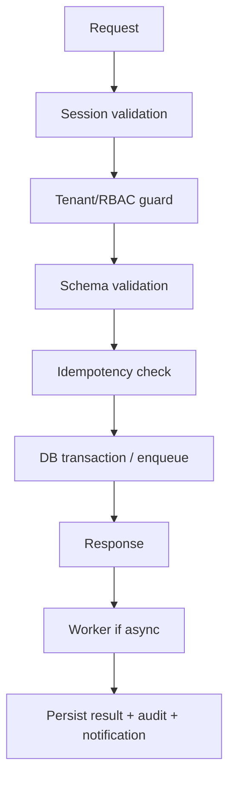

# SRS Modul GEN: Creative Engine — Backend (BE)

**Module:** Creative Engine
**Module Code:** `GEN`
**Route:** `/create, /create/{id}`
**Priority:** Very High
**Version:** 1.0
**Implementation Status:** Planned — implementation follows PRD and current repository stack.
**Source of truth:** `01_PRD.md`, `00_PROJECT_CONTEXT.md`, `TECH_STACK_AND_TANSTACK_QUERY.md`.

---

## 1. Scope and Objective

Modul ini mendefinisikan pekerjaan Backend (BE) untuk Creative Engine. Dokumen ini sengaja hanya membahas satu modul agar dapat dikerjakan paralel dengan pasangan dokumen lainnya.
Target Tahap 1 adalah alur stabil, dapat diuji juri, mobile-first, aman, serta konsisten dengan kontrak API. Fitur P1/P2 tetap dicatat tetapi tidak boleh diklaim aktif sebelum implementasi dan integrasi diverifikasi.

### 1.1 PRD Feature Coverage

- F-GEN-01 Brief Generator
- F-GEN-02 Rotasi Sudut
- F-GEN-03 Poster Generator
- F-GEN-04 Quality Gate
- F-GEN-05 Cek Keunikan
- F-GEN-06 Caption ID
- F-GEN-07 Terjemahan EN
- F-GEN-08 Format Output
- F-GEN-09 Fallback Bertanda
- F-GEN-10 Guardrail Klaim
- F-GEN-11 Kuota Generate

### 1.2 Actors and Access

| Actor | Access | Constraint |
|---|---|---|
| `CRAFTER` | Read/write tenant sendiri | Tidak melihat usaha lain |
| `DEMO_JUDGE` | Sandbox sesuai modul | Data contoh, reset terbatas |
| `ADMIN` | Monitoring/dukungan sesuai kebutuhan | Tidak membaca token mentah |
| `ADVISOR` | P2 read-only ringkasan | Tidak menjadi scope Tahap 1 |

### 1.3 Shared Contract

- TypeScript strict mode; naming mengikuti module code dan Feature ID.
- Semua request memakai session cookie Supabase; client tidak mengirim atau menyimpan secret.
- Semua response error memakai `{ error: { code, message, details? } }`.
- Semua timestamp memakai ISO 8601 UTC; UI mengonversi ke timezone pengguna.
- Semua list memakai `{ items, nextCursor }` bila berpotensi besar.

## 2. BE Responsibilities

### FR-BE-GEN-001: API Surface

Endpoint wajib/terkait: POST /api/generations; GET /api/generations/{id}; GET /api/generations/{id}/options; POST /api/generations/{id}/retry; GET /api/usage/quota.
Semua handler memakai session Supabase, authorization tenant, validation schema, structured error, dan audit untuk aksi sensitif.

### FR-BE-GEN-002: Domain Behavior

Entity domain: Generation; CreativeBrief; ContentOutput; QualityResult; UniquenessResult; AiRun; UsageQuota.
Business rules utama: Async queue; 2-3 options target; compare 20 recent posters; initial cosine threshold 0.85; max 3 retries; quality checks OCR/product/brand/artifact; fallback visibly labelled; no invented claims or prices.

### FR-BE-GEN-003: Input Contract

- Parse JSON/form-data secara eksplisit; reject unknown atau malformed input sesuai endpoint.
- ID dari client hanya kandidat; server mengambil business scope dari session dan memverifikasi ownership.
- File/URL/text divalidasi ukuran, format, panjang, content type, dan batas rate.
- Mutation idempotency key dipakai untuk publish, webhook, reset, dan operasi yang dapat diulang.

## 3. Data Model

### 3.1 Entities

| Entity | Required fields | Notes |
|---|---|---|
| Generation | `id`, `business_id`, `created_at`, `updated_at` | Tenant-scoped |
| AuditEvent | `id`, `actor_id`, `action`, `resource`, `created_at` | Immutable, redacted |
| Usage/Job record | `id`, `status`, `attempts`, `error_code` | Retry-safe when applicable |

### 3.2 Common Field Rules

- UUID primary keys; foreign keys enforced in PostgreSQL.
- `business_id` indexed and present on every tenant-owned table.
- Created/updated timestamps UTC; status values use explicit enum.
- Soft delete only when audit/history requires it; hard delete follows privacy scope.
- Media stores URL/key metadata, never arbitrary executable content.
- Secrets/tokens encrypted at rest and excluded from API serializers/logs.

### 3.3 Index and Pagination

- Index `(business_id, created_at)` for list queries.
- Add foreign-key indexes for every relation.
- Use cursor pagination for messages, generations, notifications, logs, and gallery.
- Select only required columns; never use unrestricted `select *` for large lists.
- Verify expensive SQL with `EXPLAIN ANALYZE`.

## 4. API Contract

### 4.1 Request/Response

| HTTP | Meaning | Required behavior |
|---|---|---|
| 200/201 | Success | Stable typed JSON |
| 202 | Async accepted | Return job/entity ID immediately |
| 400/422 | Invalid input | Field-safe details |
| 401 | No/expired session | No data leakage |
| 403 | Wrong role/tenant | Deny without resource details |
| 404 | Missing scoped resource | Generic not found |
| 409 | State/version conflict | Explain retry/current state |
| 429 | Rate/quota limit | Retry-after/cooldown |
| 500/503 | Dependency/system failure | Correlation ID; safe message |

Success list shape: `{ items: [], nextCursor: string | null }`.
Success mutation shape: `{ data: ..., requestId: string }`.
Error shape: `{ error: { code: string, message: string, details?: unknown, requestId: string } }`.

### 4.2 Authorization Matrix

| Action | CRAFTER | DEMO_JUDGE | ADMIN | ADVISOR |
|---|---|---|---|---|
| Read own tenant | Yes | Sandbox | Status/aggregate only | P2 read |
| Create/update own data | Yes | Sandbox | No unless support path | No |
| Approve/publish/delete | Owner explicit | Sandbox | No impersonation | No |
| Operational data | No | No | Yes | No |

Authorization is enforced server-side before database query/result serialization. RLS remains active as defense in depth.

## 5. Workflow and Jobs

Workflow domain: Backend builds brief from product/brand/memory/moment; generates options; runs gate and uniqueness; stores scores and assets; client polls; user receives options, captions ID/EN and schedule suggestion.

Background work must be bounded, observable, retry-limited, and safe on duplicate execution.
For AI work, all providers are called through `lib/ai/xkiro`/`shared ai-clients` equivalent; logging includes model, token, latency, cost, and error.

## 6. Business Rules

- `BR-GEN-001`: Async queue.
- `BR-GEN-002`: 2-3 options target.
- `BR-GEN-003`: compare 20 recent posters.
- `BR-GEN-004`: initial cosine threshold 0.85.
- `BR-GEN-005`: max 3 retries.
- `BR-GEN-006`: quality checks OCR/product/brand/artifact.
- `BR-GEN-007`: fallback visibly labelled.
- `BR-GEN-008`: no invented claims or prices.
- `BR-GEN-099`: No operation may cross business tenant boundary.
- `BR-GEN-100`: Sensitive mutation produces an audit event with actor and resource.

## 7. Validation and Security

- Validate auth/session on every protected endpoint; do not trust client-supplied businessId.
- Apply rate limit to auth, AI generation, uploads, imports, webhooks, and expensive reports.
- Enforce content type, byte limit, image dimensions, URL scheme, and SSRF-safe website fetch.
- Imported content is untrusted data; isolate it from system instructions and sanitize output.
- Redact tokens, API keys, passwords, raw prompts containing personal data, and provider secrets.
- Use parameterized Drizzle queries and database constraints.
- Publish only explicit approved output; approval status checked again immediately before publish.

## 8. Error and Recovery Matrix

| Failure | BE response | Recovery |
|---|---|---|
| Model timeout | Safe `GEN_...` error with request ID | Retry/manual fallback where safe |
| invalid structured output | Safe `GEN_...` error with request ID | Retry/manual fallback where safe |
| image generation failure | Safe `GEN_...` error with request ID | Retry/manual fallback where safe |
| OCR mismatch | Safe `GEN_...` error with request ID | Retry/manual fallback where safe |
| uniqueness failure | Safe `GEN_...` error with request ID | Retry/manual fallback where safe |
| storage failure | Safe `GEN_...` error with request ID | Retry/manual fallback where safe |
| quota exhausted | Safe `GEN_...` error with request ID | Retry/manual fallback where safe |
| all retries fail | Safe `GEN_...` error with request ID | Retry/manual fallback where safe |
| fallback unavailable | Safe `GEN_...` error with request ID | Retry/manual fallback where safe |
| Duplicate request | Existing result/status | Return same idempotent result |
| Dependency timeout | 503 or failed job state | Bounded retry; notify when terminal |

## 9. Integration and Observability

- Database: PostgreSQL/Supabase via Drizzle; migrations are versioned.
- Auth: Supabase Auth server session/cookie; RLS policy mirrors business ownership.
- Storage: HTTPS media URL requirement for Instagram; signed/private URLs where appropriate.
- AI: Xkiro adapter with timeout, fallback, safe errors, quota, and cost logging.
- Queue/scheduler: internal mechanism for async generation, publish, tasks, reminders, token refresh.
- Audit: consent, approval, delete, disconnect, reset, admin access, and security failures.
- Metrics: latency, error rate, queue age, retry count, quota, cost, and feature success.

## 10. Acceptance Criteria

- `AC-BE-GEN-001`: Request returns generationId quickly.
- `AC-BE-GEN-002`: progress is honest.
- `AC-BE-GEN-003`: terminal response contains outputs and scores.
- `AC-BE-GEN-004`: failed gate retries within limit.
- `AC-BE-GEN-005`: unique options survive.
- `AC-BE-GEN-006`: quota blocks excess.
- `AC-BE-GEN-007`: AI-created marker included.
- `AC-BE-GEN-099`: Contract tests cover auth, tenant isolation, validation, error shape, and idempotency.

## 11. BE File Convention

- Route handlers: `app/api/gen/` or resource-oriented paths from the API contract.
- Domain logic: `modules/gen/server/`.
- Validation: shared schema module; no duplicated ad-hoc parsing across handlers.
- DB schema: `lib/db/schema.ts`; migrations under `drizzle/`.
- External integrations: `lib/ai`, `lib/integrations`; secrets only environment variables.
- Every implementation task records an entry in `docs/EXECUTION_LOG.md`.

## 12. BE Test Checklist

- Unit-test validation, status transitions, quota, and business rules.
- Integration-test route handler with authenticated owner, wrong tenant, missing session, and admin.
- Test duplicate mutation/webhook/publish with same idempotency key.
- Test dependency timeout, retry ceiling, failed terminal state, and audit creation.
- Test migrations, indexes, cursor pagination, and RLS policies.
- Run `npm run lint` and `npm run build`; keep a small runnable check for non-trivial logic.

## 13. Handoff Notes

FE dan BE wajib menggunakan Feature ID, enum status, error code, and response shape dari dokumen ini. Perubahan kontrak harus mengubah pasangan SRS FE/BE secara bersamaan.
Tidak ada secret, credential demo, atau token eksternal di repository.

*End of SRS_BE_GEN — Creative Engine*
