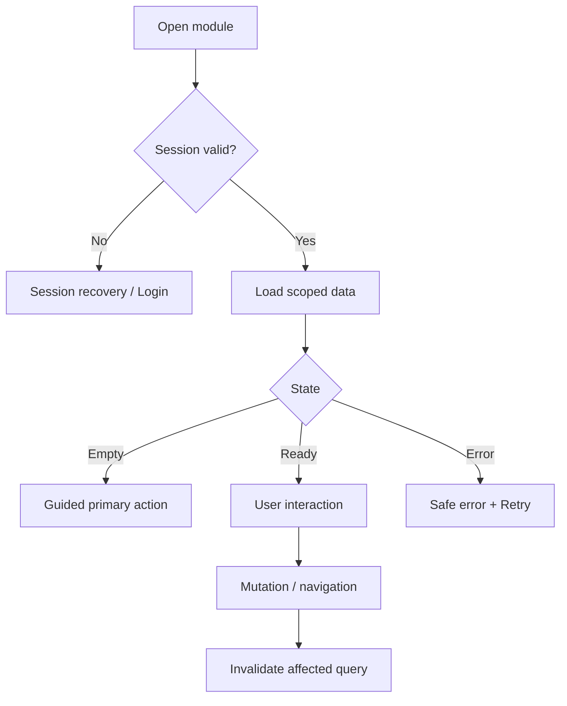

# SRS Modul WA: Kanal WhatsApp — Frontend (FE)

**Module:** Kanal WhatsApp
**Module Code:** `WA`
**Route:** `/api/webhooks/whatsapp`
**Priority:** Low / Opsional
**Version:** 1.0
**Implementation Status:** Planned — implementation follows PRD and current repository stack.
**Source of truth:** `01_PRD.md`, `00_PROJECT_CONTEXT.md`, `TECH_STACK_AND_TANSTACK_QUERY.md`.

---

## 1. Scope and Objective

Modul ini mendefinisikan pekerjaan Frontend (FE) untuk Kanal WhatsApp. Dokumen ini sengaja hanya membahas satu modul agar dapat dikerjakan paralel dengan pasangan dokumen lainnya.
Target Tahap 1 adalah alur stabil, dapat diuji juri, mobile-first, aman, serta konsisten dengan kontrak API. Fitur P1/P2 tetap dicatat tetapi tidak boleh diklaim aktif sebelum implementasi dan integrasi diverifikasi.

### 1.1 PRD Feature Coverage

- F-WA-01 Link Nomor
- F-WA-02 Webhook & Balasan
- F-WA-03 Template
- F-WA-04 Idempotency & Retry
- F-WA-05 Bot Spesifik
- F-WA-06 Kontrol Biaya

### 1.2 Actors and Access

| Actor | Access | Constraint |
|---|---|---|
| `CRAFTER` | Read/write tenant sendiri | Tidak melihat usaha lain |
| `DEMO_JUDGE` | Sandbox sesuai modul | Data contoh, reset terbatas |
| `ADMIN` | Monitoring/dukungan sesuai kebutuhan | Tidak membaca token mentah |
| `ADVISOR` | P2 read-only ringkasan | Tidak menjadi scope Tahap 1 |

### 1.3 Shared Contract

- TypeScript strict mode; naming mengikuti module code dan Feature ID.
- Semua request memakai session cookie Supabase; client tidak mengirim atau menyimpan secret.
- Semua response error memakai `{ error: { code, message, details? } }`.
- Semua timestamp memakai ISO 8601 UTC; UI mengonversi ke timezone pengguna.
- Semua list memakai `{ items, nextCursor }` bila berpotensi besar.

## 2. FE Responsibilities

### FR-FE-WA-001: Screen and Route

FE menyediakan layar: Optional WhatsApp connection settings; webhook has no UI screen; notification preference. Route harus mengikuti App Router dan protected-route policy.

### FR-FE-WA-002: Shared Components

Komponen minimum: WhatsAppConnectionCard, LinkCodeField, OptInNotice, DeliveryStatus, OptionalChannelBadge.
Komponen reusable diprioritaskan; jangan membuat state global baru jika local state cukup.

### FR-FE-WA-003: Server State

- Gunakan TanStack Query untuk response API; query key harus memasukkan businessId/entity ID yang relevan.
- `staleTime` mengikuti karakter data; mutation tidak auto-retry.
- Invalidate hanya key terdampak setelah server mutation sukses.
- Polling hanya untuk status asinkron dan berhenti pada status terminal.
- Jangan memasukkan token, credential, atau payload sensitif ke query key/cache.

### FR-FE-WA-004: Form and Validation

- Validasi client memberi umpan balik cepat; server tetap menjadi sumber validasi final.
- Field wajib diberi label, hint, error text, dan `aria-describedby`.
- Tombol submit disabled saat mutation berjalan; cegah double submit.
- Input file memvalidasi format, ukuran, jumlah, dan preview sebelum upload.
- Data draft yang aman dipertahankan saat offline/session expired; jangan menyimpan secret.

## 3. UI/UX Specification

### 3.1 Layout

1. Layar utama menampilkan konteks Kanal WhatsApp tanpa mengandalkan warna saja.
2. Mobile-first pada lebar 360–414 px; layout desktop mendukung minimal 1280 px untuk juri.
3. Primary action selalu terlihat; secondary action tidak mengalahkan aksi aman.
4. State loading menggunakan skeleton/progress yang menjelaskan pekerjaan sebenarnya.
5. Empty state selalu memberi langkah berikutnya, bukan hanya teks kosong.
6. Error state menyediakan retry atau jalur manual yang jelas.

### 3.2 Accessibility and i18n

- Kontras minimum WCAG AA; target sentuh sekitar 44–48 px.
- Semua input memiliki label; dialog mengatur focus trap dan tombol Escape.
- Status selalu memakai kombinasi ikon, teks, dan warna.
- Mendukung Bahasa Indonesia sebagai default dan Inggris sebagai pilihan.
- Teks panjang, nama usaha, caption, dan zoom browser tidak boleh merusak layout.
- Hormati `prefers-reduced-motion`; jangan menjadikan animasi sebagai satu-satunya indikator.

### 3.3 State Matrix

| State | FE behavior | User action |
|---|---|---|
| Initial/loading | Skeleton atau progress kontekstual | Menunggu atau meninggalkan halaman |
| Success | Data/content tampil; toast seperlunya | Lanjut ke aksi berikut |
| Empty | Penjelasan dan CTA | Membuat data pertama |
| Validation error | Error dekat field | Memperbaiki input |
| API error | Pesan aman dan retry | Coba lagi/jalur manual |
| Offline | Banner; jangan hapus draft | Reconnect |
| Session expired | Dialog/redirect login | Login ulang |

## 4. FE Data and API Wiring

Endpoint yang dikonsumsi: POST /api/integrations/whatsapp/link; POST /api/webhooks/whatsapp; GET /api/integrations/whatsapp/status; DELETE /api/integrations/whatsapp.
Setiap hook menggunakan `lib/api-client.ts`; response dipetakan ke tipe domain, bukan `any`.

### 4.1 Query/Mutation Table

| Operation | Query key / mutation | Invalidation |
|---|---|---|
| Read list/detail | `waList`, `waDetail` | Refetch bila stale |
| Create/update | `waMutation` | Invalidate affected entity/list |
| Delete/cancel | `waDelete` | Remove detail; invalidate list |
| Async status | entity status key | Poll only while queued/processing |

### 4.2 API Response Expectations

- Success response harus memiliki shape stabil dan dapat ditipkan.
- HTTP 401 memicu session recovery; 403 menampilkan access restricted; 404 menampilkan not found; 409 menjelaskan konflik.
- HTTP 422 memetakan `details.field` ke form; HTTP 429 menampilkan cooldown; HTTP 5xx menyediakan retry.
- FE tidak menampilkan stack trace, SQL, provider error mentah, access token, atau API key.

## 5. User Flow

Alur spesifik: User requests one-time code; sends it to bot; backend links number; inbound message maps to agent core; response uses allowed channel format; failures retry safely.

## 6. Acceptance Criteria

- `AC-FE-WA-001`: Unverified module is clearly unavailable.
- `AC-FE-WA-002`: valid webhook produces one agent event.
- `AC-FE-WA-003`: duplicate webhook no duplicate action.
- `AC-FE-WA-004`: unauthorized signature rejected.
- `AC-FE-WA-005`: template restriction enforced.
- `AC-FE-WA-006`: disconnect removes link.
- `AC-FE-WA-099`: UI memenuhi keyboard navigation, responsive layout, ID/EN text, dan safe error handling.

## 7. Edge Cases and Error Handling

- **Invalid signature:** tampilkan feedback yang dapat ditindaklanjuti; pertahankan data aman; jangan bocorkan detail internal.
- **duplicate event:** tampilkan feedback yang dapat ditindaklanjuti; pertahankan data aman; jangan bocorkan detail internal.
- **expired code:** tampilkan feedback yang dapat ditindaklanjuti; pertahankan data aman; jangan bocorkan detail internal.
- **window closed:** tampilkan feedback yang dapat ditindaklanjuti; pertahankan data aman; jangan bocorkan detail internal.
- **template rejected:** tampilkan feedback yang dapat ditindaklanjuti; pertahankan data aman; jangan bocorkan detail internal.
- **Meta outage:** tampilkan feedback yang dapat ditindaklanjuti; pertahankan data aman; jangan bocorkan detail internal.
- **delivery failure:** tampilkan feedback yang dapat ditindaklanjuti; pertahankan data aman; jangan bocorkan detail internal.
- **cost limit reached:** tampilkan feedback yang dapat ditindaklanjuti; pertahankan data aman; jangan bocorkan detail internal.
- Double click tidak membuat mutation ganda.
- Navigasi saat request aktif tidak menyebabkan crash atau state korup.
- Unmount menghentikan polling dan object URL lokal dibersihkan.

## 8. FE File Convention

- Route: `app/api/webhooks/whatsapp/page.tsx`.
- Feature components: `modules/wa/components/`.
- Hooks: `hooks/use-wa.ts` atau module-local hook.
- Types: `modules/shared/types` atau domain type terdekat.
- API access: `lib/api-client.ts`; query client: `lib/query-client.ts`.
- UI tokens berasal dari designer; jangan hardcode warna/typography tanpa token.

## 9. FE Test Checklist

- Render loading, success, empty, error, offline, dan session-expired state.
- Test field validation dan keyboard/focus order.
- Test mutation success, 401/403/409/422/429/5xx.
- Test query invalidation dan tidak ada duplicate request.
- Test tenant data tidak tampil pada response yang salah.
- Jalankan `npm run lint` dan `npm run build`.

## 10. FE Handoff Notes

FE tidak boleh mengasumsikan fitur backend yang belum tersedia. Gunakan mock response berbasis kontrak ini, lalu ganti `queryFn` tanpa mengubah komponen ketika endpoint siap.
Pasangan BE wajib menjaga field, enum status, error code, dan permission yang dicantumkan dalam SRS BE modul yang sama.

*End of SRS_FE_WA — Kanal WhatsApp*
